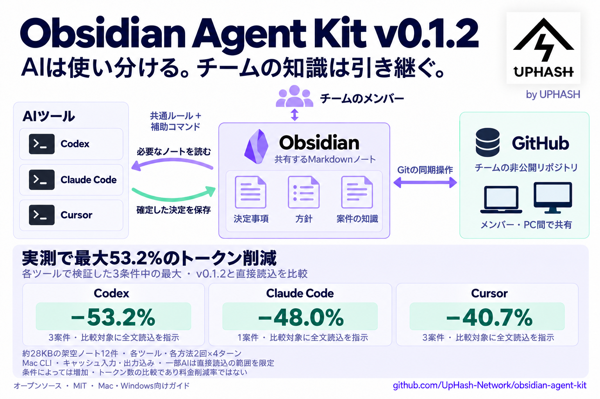

[](https://uphash.net/)

# Obsidian Agent Kit — by UPHASH

**人とCodex・Claude Code・Cursorで、必要な知識を共有する仕組み。**

**必要なノートだけを読み、既知の内容を再利用。ノートの更新も確認します。**

[English](README.md) · [導入ガイド](docs/setup.ja.md) · [検証手順](docs/verification.ja.md) · [UPHASH](https://uphash.net/)

**v0.1.2・MITライセンス。** [株式会社UPHASH](https://uphash.net/)が開発・公開する、
人とAIがツールやチームをまたいで知識を共有するためのキットです。
コード・共通ルール・ガイド・架空サンプルは[MITライセンス](LICENSE)で利用・改変・再配布できます。
UPHASHのロゴ素材には[別の紹介用途の条件](docs/branding.md)があります。

決定事項や方針を普通のMarkdownに残し、AIが関連ノートだけを読みます。
同じ会話で把握済みの内容は再利用し、作業再開・最新確認・編集時にはSHA-256で
変更を確認します。人はObsidianで編集し、チームのノートは別の非公開Gitリポジトリで
共有します。個人用はローカルに保ちます。



[日本語画像を拡大](docs/assets/agent-kit-v0.1.2-ja.png) · [English image](docs/assets/agent-kit-v0.1.2-en.png)

## トークン使用量の実測

**各ツールで検証した3条件のうち、最も削減できた条件の結果です。**
各条件の2回×4ターンを合算しています。最大値を得た案件数はツールによって異なります。

| ツール | 直接読込 | v0.1.2利用時 | 削減率 | 条件 |
|---|---:|---:|---:|---|
| Codex | 703,457 | 329,232 | **53.2%** | 3案件・全文読込指示 |
| Claude Code | 308,372 | 160,313 | **48.0%** | 1案件・全文読込指示 |
| Cursor | 508,440 | 301,261 | **40.7%** | 3案件・全文読込指示 |

測定日：**2026年10月21日**。**約28KBの架空英語ノート12件**と方針ノートを用意し、
Mac CLIで各ツール・各方法2回×4ターンを測定しました。数値はキャッシュ入力を1回分として
含む入力＋出力の合計トークン数です。GPT-6.1-sol、Claude Opus 5、Composer 2.5を使用し、
キャッシュは消去していません。全文読込を指示してもAIが範囲を絞ったり、切れた出力を
追加取得したりした場合があり、その処理も計上しています。

キット側は**18/18セッションで更新を検知**しました。ファイルサイズ・更新時刻を保持した
変更も対象です。直接読込側も全件で更新を検知しています。キットの回答は
**72/72ターンで期待する事実と一致**し、JSONだけの厳密な形式は63/72でした。

検証内の最大値で、平均的・保証された削減率ではありません。別の条件では使用量が
増えています。料金やアカウント上限の削減率でもありません。
[全9比較・正確さ・測定条件](benchmarks/v0.1.2/README.ja.md) ·
[実測データ](benchmarks/v0.1.2/summary.json) ·
[自分の業務での比較手順](docs/verification.ja.md#トークン数の比較)

## なぜトークンを節約できるのか

**v0.1.2ではルールと読込の負担を減らしました。** 共通コマンドの記載を1回にし、
必要な章が分かっていれば初回から取得します。指定章の抜粋に大きな目次を繰り返し付けず、
短い出力でもファイル全体のSHA-256による更新確認を維持します。
[使い方](docs/compact-context.md#日本語)と[3ツールの直接読込との比較](benchmarks/v0.1.2/README.ja.md)を公開しています。
[v0.1.2の英日画像](docs/assets/README.md)には、最大削減率と測定条件を記載しています。

Vault全体、過去の会話、変更のないノートを何度も取得すると、AIの会話へ余分な本文が
追加されます。このキットは、次の方法で入力の重複を減らします。

- **読む量を絞る：** 方針と関連ノート1〜2件から始め、必要な節だけを読みます。
  確定した決定を簡潔に残すことで、別の会話でも必要な知識を見つけやすくします。
- **把握済みの事実を使う：** 直後の言い換えなどは会話内の知識で答え、ノート取得と
  同じ本文の追加を省きます。
- **更新確認を短くまとめる：** 既知のノートと方針を1回で確認します。変更なしなら
  短い情報と `UNCHANGED`、変更ありなら新しい抜粋をその場で返します。
  判断に必要な未読部分は追加で読みます。

たとえば、変更のないノートを3回全文取得すると、**本文3回分**が会話に追加されます。
最初に読み、2回の作業再開時に変更確認する場合は、**本文1回分＋短い確認結果2回分**で
済みます。これは重複するツール出力を減らす説明例で、総トークン数や料金の実測ではありません。

既存の会話履歴も入力トークンに数えられる場合があり、ルール・ハッシュ・ツール呼び出しにも
負担があります。長いノートを繰り返し使う作業ほど効果を得やすく、短い単発作業や、もともと
再読しない使い方では削減が小さい、または増える場合もあります。削減率は環境ごとに異なります。

## 日々の動作

| 場面 | 期待する動作 |
|---|---|
| 本格的な作業開始 | 方針と関連ノート1〜2件だけを読む |
| 既知の内容の言い換え | ノートを再読せず回答する |
| 再開・最新確認・編集 | 1回のコマンドで対象のハッシュを確認する |
| 変更なし | 本文を含まない `UNCHANGED` を返す |
| 変更あり | その呼び出しで新しい抜粋とハッシュを返す |
| 再利用する決定が確定 | 既存ノートに保存し、変更箇所を一度検証する |

ハッシュは会話内で保持します。変更確認ではローカルのファイルを読みますが、
同じ本文をモデルへ何度も渡すことを避けます。ルールはAIへの指示なので、実際の
動作確認が必要です。トークン削減率はモデル・課題・キャッシュ等に依存します。

## 架空のデモを試す

Python **3.10以上**を使います。取得・更新にはGit、画面操作にはObsidianと各AI
クライアントを用意します。補助コマンドには追加Pythonパッケージ、MCPサーバー、
APIキーは不要です。AI側の認証・権限・利用料金は別です。

macOS / Linux:

```sh
git clone https://github.com/UpHash-Network/obsidian-agent-kit.git
cd obsidian-agent-kit
python3 -m unittest discover -s tests -v
python3 demo.py init --dest ../oak-demo
```

Windows PowerShell:

```powershell
git clone https://github.com/UpHash-Network/obsidian-agent-kit.git
Set-Location obsidian-agent-kit
py -3 -m unittest discover -s tests -v
py -3 demo.py init --dest ../oak-demo
```

新しい保存先を指定します。既存フォルダには作成しません。普段のAI設定は変更せず、
架空Vaultと3ツールそれぞれのルールを作ります。

1. Obsidianで `../oak-demo/vault` を開き、`Welcome.ja.md` を読みます。
2. AI側では `../oak-demo/codex`、`claude`、`cursor` のうち対応するフォルダを
   開き、通常のWorkspace Trust確認を済ませ、新しい会話を開始します。
3. 「このフォルダのルールに従い、架空のLighthouse案件のリリースチャネル・
   レビュー担当・未決事項を確認して」と依頼します。blue／Mira／承認が必要・日付未定が正解です。
4. 「この会話で確認済みの事実を一文に言い換えて」と依頼します。再読なしが期待動作です。
5. リポジトリ側で `python3 demo.py change --dest ../oak-demo` を実行します。
   Windowsでは `python3` を `py -3` に置き換えます。サイズ・更新時刻を維持したままblueがtealに変わります。
6. 「作業を再開します。Lighthouseの最新のローカル方針と決定を確認して」と依頼します。
   1回のまとめた確認でtealを取得することを確かめます。

回答だけでなくツール履歴も確認します。別ツールを試すときは新しいデモ保存先を
作ってください。[検証手順](docs/verification.ja.md)には決定事項の保存確認もあります。

## 自分やチームで使う

[日本語の導入ガイド](docs/setup.ja.md)に、所属別Vault、非公開Git同期、3ツールの
設定、更新・解除手順をまとめています。各PCのパスはそのPCだけに設定します。

**Mac・Windowsの新しいメンバー**は、導入ガイドのv0.1.2固定取得から始め、Codex・Claude Code・
Cursorで[日常環境の動作確認](docs/verification.ja.md#日常環境の動作確認)まで行ってください。
通常のログイン・信頼確認、Cursor画面でのルール登録、固定helperの権限、架空ノートでの
読込→再利用→更新検知→保存を確認できます。Obsidianの導入やdoctor成功だけで完了にはしません。

コードはこの公開リポジトリ、業務のノートは別の非公開リポジトリ、個人ノートは
ローカルに置きます。ルールと補助コマンドはアクセス制御の代わりではありません。
OS・GitHub・AIクライアントの権限も設定してください。

- Git同期の自動設定・自動実行は行いません。ハッシュ確認の対象はローカルファイルです。
- 補助コマンドは読み取り専用です。ノートの保存にはAIの通常の編集機能を使います。
- CursorのUser Rulesには画面からの登録が必要です。デモはプロジェクトルールを使います。
  TabやInline Editに同じ動作を保証しません。
- Buzzによる議事録処理とBasic Memory連携はv0.1に含めません。
- 業務ノート、実会議、録画、モデル、個人ログは含めません。各ツールの公式製品ではありません。

[検証手順](docs/verification.ja.md) · [プライバシー](SECURITY.md) ·
[フィードバック](CONTRIBUTING.md) · [変更履歴](CHANGELOG.md)

## UPHASHがつくり、世界へ共有する

[UPHASH](https://uphash.net/)は、研究チームとともに技術を実装へつなげる会社です。
このキットでは、人・PC・AIツールが変わっても決定事項や方針を活用できる方法を公開しています。
[UPHASHについて](https://uphash.net/) · [GitHubの公開プロジェクト](https://github.com/UpHash-Network)

役に立ったら、任意でリンクや紹介バッジを掲載していただけるとうれしいです。

[](https://github.com/UpHash-Network/obsidian-agent-kit)

貼り付け用のコードは[紹介・ロゴのガイド](docs/branding.md)にあります。宣伝の掲載は任意です。
MITで必要な著作権表示と許諾文は、コピーや主要部分の再配布時に保持してください。
利用者自身の業務ノートを公開する必要はありません。改善案は架空の例で共有できます。
