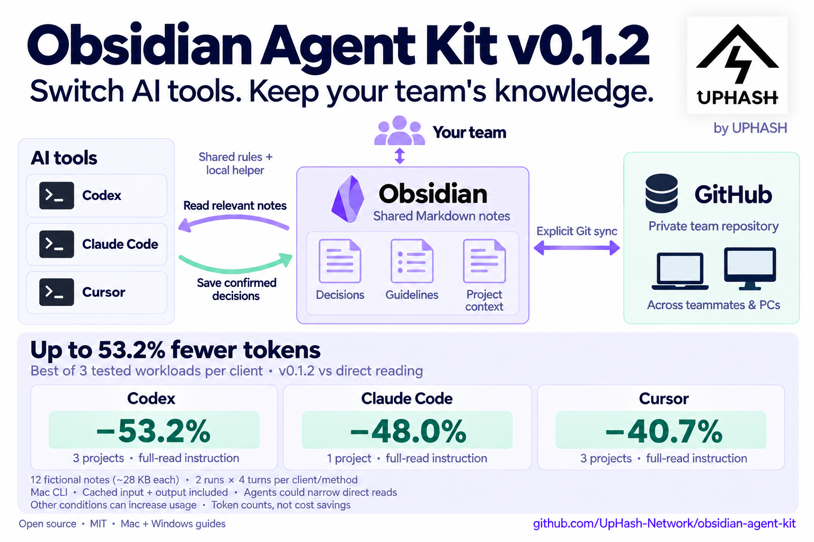

[](https://uphash.net/)

# Obsidian Agent Kit — by UPHASH

**Shared knowledge for people, Codex, Claude Code, and Cursor.**

**Focused reads, reusable context, and checks for changed notes.**

[日本語](README.ja.md) · [Setup](docs/setup.md) · [Verification](docs/verification.md) · [UPHASH](https://uphash.net/)

**v0.1.2 · MIT licensed.** Created and maintained by [UPHASH Inc.](https://uphash.net/)
to help people and coding agents share useful knowledge across tools and teams.
Use, adapt and redistribute the code, rules, guides and fictional examples under
the [MIT License](LICENSE). UPHASH logo assets have [separate attribution terms](docs/branding.md).

Keep useful decisions in ordinary Markdown. Let coding agents read only the
relevant notes, reuse what they already know, and check for changes when needed.
Keep team knowledge in a separate private Git repository; keep personal knowledge
local. Obsidian is the human editor, and Git can synchronize the team's files.



[Full-size English image](docs/assets/agent-kit-v0.1.2-en.png) · [日本語画像](docs/assets/agent-kit-v0.1.2-ja.png)

## Measured token usage

**Best observed reduction for each client, among three tested workloads.**
Each total combines both four-turn runs; the winning workload differs by client.

| Client | Direct reading | With v0.1.2 | Reduction | Workload |
|---|---:|---:|---:|---|
| Codex | 703,457 | 329,232 | **53.2%** | 3 projects, full-read instruction |
| Claude Code | 308,372 | 160,313 | **48.0%** | 1 project, full-read instruction |
| Cursor | 508,440 | 301,261 | **40.7%** | 3 projects, full-read instruction |

Measured **2026-10-21** on macOS CLIs using **12 fictional English notes of about
28 KB each**, plus a policy. Two runs × four turns per client/method; input
including cache counted once, plus output. Models: GPT-6.1-sol, Claude Opus 5,
and Composer 2.5. Provider caches were not cleared. Full-read instructions
sometimes produced narrower reads or recovery calls; all are included.

The kit detected updates in **18/18 sessions**, including a change with identical
file size and modification time; direct reading also detected every update.
Kit answers matched the expected facts in **72/72 turns**; strict JSON-only
format passed in 63/72.

These are selected maxima, not typical or guaranteed savings. Some other
conditions increased usage; token totals are not billed cost or quota savings.
[All nine comparisons, correctness and conditions](benchmarks/v0.1.2/README.md) ·
[Counter data](benchmarks/v0.1.2/summary.json) ·
[Measure your own workflow](docs/verification.md#token-measurement)

## How this can save tokens

**v0.1.2 reduces rule and retrieval overhead.** The common command appears once;
known sections can be fetched on the first call without a repeated large outline.
Compact output keeps full-file SHA-256 checks. See the
[usage guide](docs/compact-context.md) and [three-client direct-read comparison](benchmarks/v0.1.2/README.md).
The [v0.1.2 graphics](docs/assets/README.md) include bilingual diagrams and
conditions for the best observed reductions.

Repeatedly loading whole vaults, old chats or unchanged notes adds unnecessary
text to an AI conversation. This kit helps reduce that input by:

- **Reading less:** start with the policy and 1–2 relevant notes, using focused
  sections when needed. Keep durable decisions concise so new sessions can find them.
- **Reusing facts:** an immediate follow-up can use what is already in the chat,
  with no new note request or duplicate tool result.
- **Checking changes compactly:** one call checks known notes and policy together.
  Unchanged files return short metadata and `UNCHANGED`; changed files return a
  fresh excerpt in the same call. Important omitted sections still need reading.

For example, fetching an unchanged note three times adds **three copies of its
body**. Reading it once and checking it on two later resumptions adds **one body
plus two short check results**. This illustrates avoided duplicate tool output;
it is not a measurement of total model tokens or cost.

The earlier conversation may still count toward input tokens, and rules, hashes
and tool calls have overhead. The largest opportunity is repeated work with
substantial notes; tiny, one-off tasks or clients that already avoid rereads may
save little or even use more. Actual totals depend on the model, task and caching.

## What changes in daily work?

| Situation | Expected agent behavior |
|---|---|
| Start substantive work | Read the policy and 1–2 relevant notes |
| Rephrase an answer using known facts | Reuse the conversation; zero note calls |
| Resume work, request current facts, or edit a note | One batched SHA-256 check |
| Same content | Receive `UNCHANGED`, without the note body |
| Changed content | Receive the new excerpt and hash in that same call |
| Confirm a reusable decision | Update its existing note and verify once |

The hash is kept in the conversation, not in a persistent cache. Hash checks
still read local bytes; they avoid resending unchanged bodies to the model.
Rules guide model behavior, so real-client verification matters. Savings vary
with the task, model, context and caching; no percentage is guaranteed.

## Quick demo

Prerequisites: Python **3.10+**. Git is needed to clone/update; Obsidian and an AI
client are optional for the automated tests. No extra Python packages, MCP server
or API key are required by the helper. AI clients have their own authentication,
permissions and charges.

macOS / Linux:

```sh
git clone https://github.com/UpHash-Network/obsidian-agent-kit.git
cd obsidian-agent-kit
python3 -m unittest discover -s tests -v
python3 demo.py init --dest ../oak-demo
```

Windows PowerShell:

```powershell
git clone https://github.com/UpHash-Network/obsidian-agent-kit.git
Set-Location obsidian-agent-kit
py -3 -m unittest discover -s tests -v
py -3 demo.py init --dest ../oak-demo
```

The destination must not exist. This creates **fictional notes and local rules**,
without modifying global AI settings. Open `../oak-demo/vault` as an Obsidian
vault and start with `Welcome.md` or `Welcome.ja.md`. Open the corresponding
`codex`, `claude`, or `cursor` directory as your
AI workspace and complete its normal workspace-trust prompt. Start a new chat.

1. Ask: **“For the fictional Lighthouse project, what are the release channel,
   reviewer, and unresolved release conditions? Follow this workspace's rules.”**
   Expect blue, Mira, approval required, and no decided release date.
2. Ask: **“Rephrase that in one sentence using the facts already in this chat.”**
   Expect no note/tool call.
3. From this repository directory, run
   `python3 demo.py change --dest ../oak-demo` (Windows: `py -3`). This changes
   blue to teal while retaining the note's size and modification time.
4. Ask: **“We are resuming substantive work. Verify the current local Lighthouse
   decisions and policy, then summarize.”** Expect one batched hash check and teal.

Inspect tool activity, not just the final answer. Repeat with a fresh demo
destination for each client; see [the acceptance checklist](docs/verification.md).

## Use your own knowledge

[English setup](docs/setup.md) and [日本語の導入ガイド](docs/setup.ja.md) cover scoped
vaults, private Git sync, global installation, Cursor User Rules, updates and removal.
Configure each PC's own paths. Never commit local configurations or generated demo
workspaces to this public repository.

For a new teammate on **Mac or Windows**, follow the v0.1.2 pinned-release commands
in the setup guide, then the [installed-environment checks](docs/verification.md#installed-environment-check)
in Codex, Claude Code and Cursor. The guide covers normal client login/trust,
Cursor's actual User Rule, narrow helper permissions, and a fictional read → reuse →
update → save exercise. Installing Obsidian or passing `doctor` alone is not enough.

| File | Purpose |
|---|---|
| `rules.md` | Single rule template shared by all three clients |
| `obsidian_context.py` | Read-only, scoped Markdown helper |
| `setup.py` | Configure, install with backups, and doctor |
| `demo.py` | Isolated fictional demo with per-client rules |
| `examples/demo-vault/` | Fictional policy, projects and decision template |
| `tests/` | Hash freshness, isolation, installation and demo tests |
| `docs/verification.md`, `docs/verification.ja.md` | English/Japanese automated and real-client checks |

## Boundaries

- No automatic Git pull/push, daemon, embedding database or cloud storage.
- Only local files are checked. Sync the correct private vault at work boundaries
  and resolve conflicts before calling facts current.
- Rules and helper confinement are **not** an access-control boundary for the AI
  client. Use OS permissions, repository access and client permissions.
- The helper does not edit notes. Note writes use the client's normal authorized
  editing tools, preserving human annotations and distinguishing proposals.
- Cursor rules apply to Agent workflows; do not assume they govern Tab or Inline
  Edit. Global User Rules require a normal UI step; project rules are in the demo.
- Meeting transcription/Buzz and Basic Memory integrations are outside v0.1.
  No business transcripts, private benchmarks, recordings, models or client logs
  are included. This project is independent of the named tool vendors.

See [verification instructions](docs/verification.md), [privacy](SECURITY.md),
[feedback](CONTRIBUTING.md), and [release notes](CHANGELOG.md).

## Made by UPHASH, shared with everyone

[UPHASH](https://uphash.net/) works with research teams to turn technical ideas
into working software. This kit shares a practical way to keep durable knowledge
useful across people, PCs and AI tools. [Meet UPHASH](https://uphash.net/) ·
[Explore our GitHub](https://github.com/UpHash-Network).

If the kit helps your team, an optional link or badge helps others discover it:

[](https://github.com/UpHash-Network/obsidian-agent-kit)

Copy the badge from the [branding guide](docs/branding.md). Visible promotion is
optional; the MIT copyright and license notices must still accompany copies or
substantial portions. Your own notes stay yours and may remain private. Share
feedback using fictional examples, never your team's confidential knowledge.
