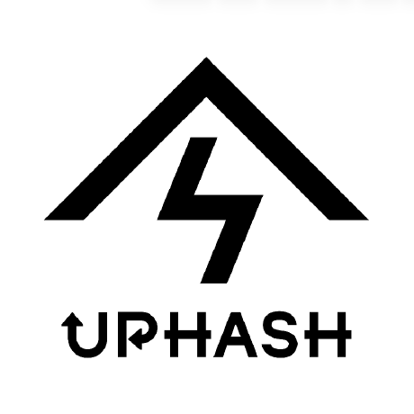

# Obsidian Agent Kitへようこそ — by UPHASH

[English](Welcome.md) · [プロジェクトと更新情報](https://github.com/UpHash-Network/obsidian-agent-kit) · [UPHASH](https://uphash.net/)

**UPHASH**の練習用Vaultです。案件・人物・決定事項は架空で、UPHASHの業務記録ではありません。

## 3ツールで共通の知識を使う

1. 作成したVaultと同じデモフォルダ内の `codex`・`claude`・`cursor` から、使うツールの
   作業フォルダを開きます。通常の認証・信頼確認を済ませ、新しい会話を開始します。
2. [Lighthouse](Projects/Lighthouse.md)のリリースチャネル・レビュー担当・未決事項を
   確認します。blue／Mira／承認が必要／日付未定が正解です。
3. 確認済みの内容を一文に言い換えるよう依頼します。ノートの再読なしが期待動作です。
4. キットのフォルダで、このデモの保存先を指定して `demo.py change --dest ...` を実行し、
   作業を再開して最新の決定を確認します。1回のまとめた確認でtealが返ることを確かめます。

正確なコマンドは[導入ガイド](https://github.com/UpHash-Network/obsidian-agent-kit/blob/main/docs/setup.ja.md)、
人が確認した決定の保存は[検証手順](https://github.com/UpHash-Network/obsidian-agent-kit/blob/main/docs/verification.md)
を参照します。[Orchard](Projects/Orchard.md)は別案件なので、この練習では読む必要がありません。

## 自分のVaultへ

構成を参考に、チームごとの非公開Vaultや個人用のローカルVaultを別に用意できます。
架空の本文と方針は、実際に承認された内容へ置き換えます。会話原本・録画・認証情報・
PC固有設定は共有ノートへ入れません。

ガイド・ルール・架空の本文は[MITライセンス](LICENSE)です。自分のノートを公開する必要は
ありません。ロゴには[別の紹介用途の条件](Assets/UPHASH/README.md)があります。
自分のVaultではこの案内ページを削除できます。利用する素材に必要なライセンス表記は保持してください。

[UPHASH](https://uphash.net/)は、人と複数AIの間で知識を活用するために、このキットを公開しています。
任意のリンクや[紹介バッジ](https://github.com/UpHash-Network/obsidian-agent-kit/blob/main/docs/branding.md)で
元のプロジェクトを紹介できます。改善案は架空の例で共有してください。
